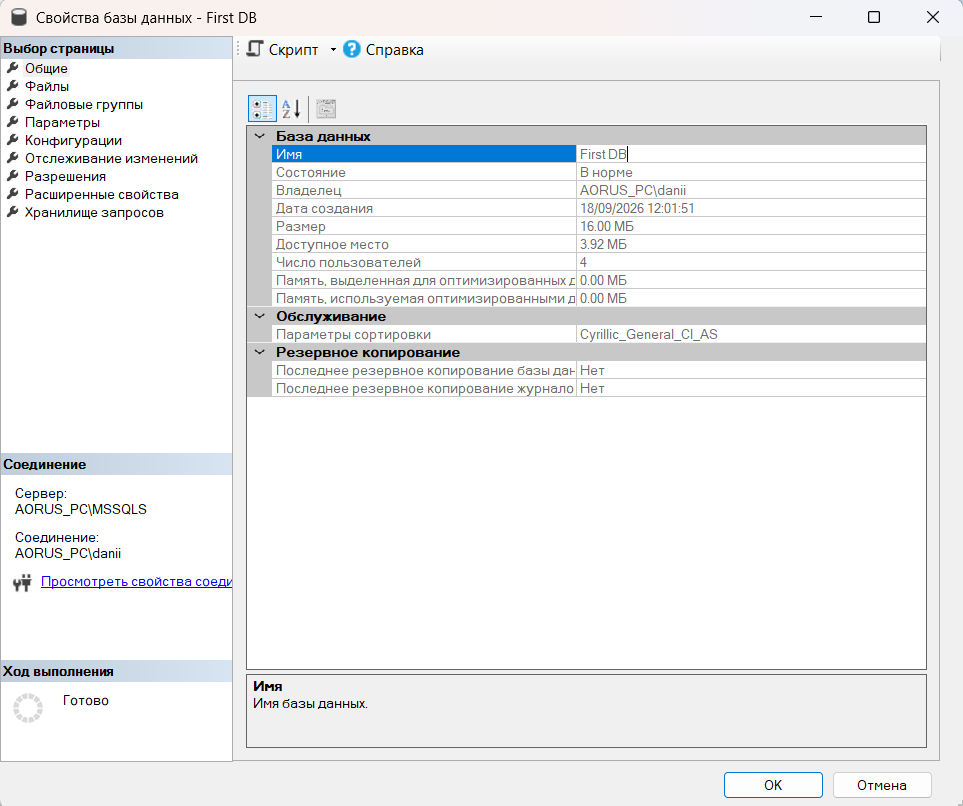
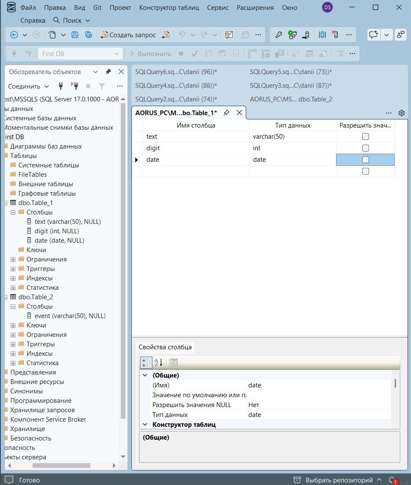
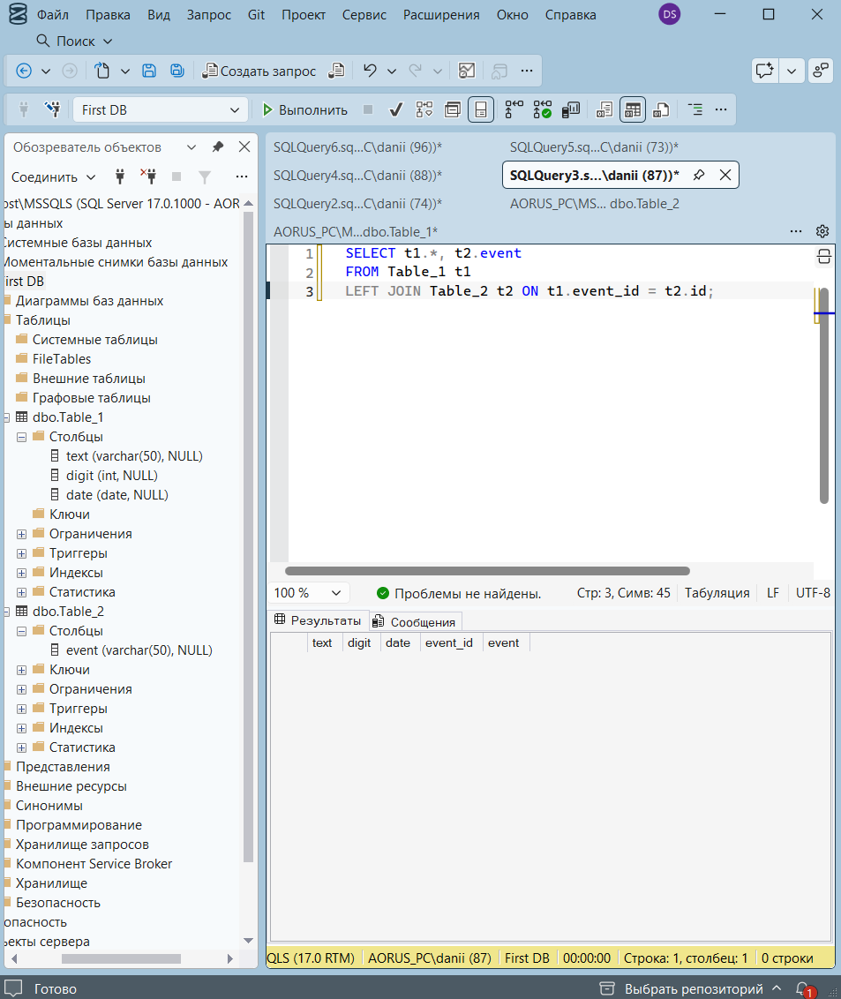
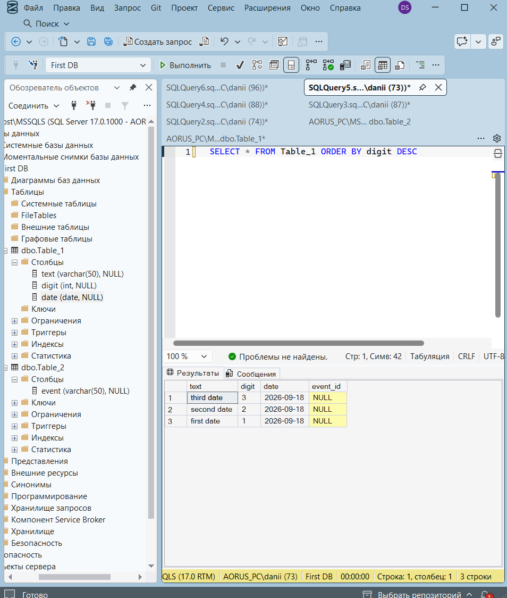
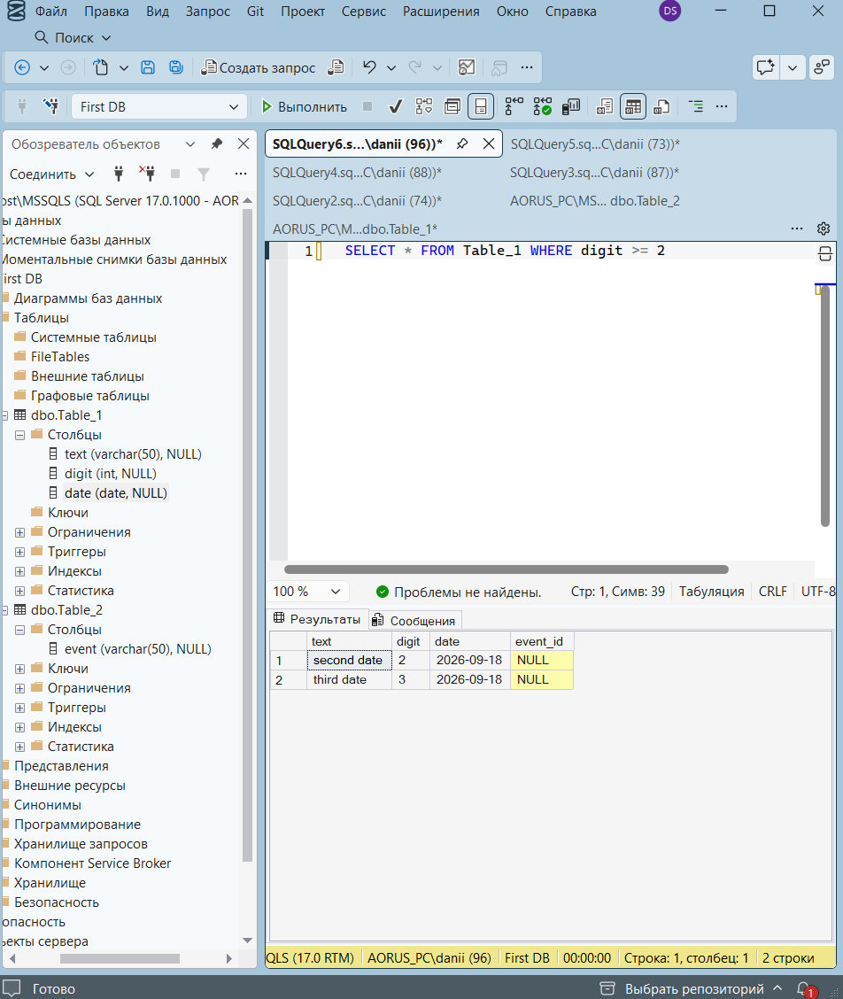

Часть 1

Что такое Object Explorer и какие объекты там можно увидеть?
 Object Explorer — окно для просмотра объектов SQL Server: баз данных, таблиц, безопасности и других объектов сервера.

Для чего нужно окно New Query?
 Для написания и выполнения SQL-запросов.

Какие папки Object Explorer вы заметили и что в них находится?
 Databases — базы данных; Security — настройки безопасности; Server Objects — объекты сервера.

Часть 2

Какие настройки базы данных можно изменить при создании?
 Имя базы, расположение файлов и их размер.

Чем отличается удаление базы от её переименования?
 При удалении база полностью удаляется, а при переименовании сохраняется, меняется только её имя.

Почему важно правильно выбирать имя базы данных?
 Чтобы её было легко идентифицировать и находить.

Часть 3

Какие типы данных вы использовали для колонок и почему?
 Текстовые, числовые и даты — для хранения соответствующих типов информации.

Для чего нужны ключи PRIMARY KEY и FOREIGN KEY?
 PRIMARY KEY уникально идентифицирует запись, а FOREIGN KEY связывает таблицы.

Как изменение структуры таблицы влияет на данные?
 Добавление или удаление колонок изменяет структуру и может повлиять на хранимые данные.

Часть 4

Чем отличается добавление данных от их изменения?
 Добавление создаёт новую запись, изменение корректирует существующую.

Как фильтры и сортировка помогают работать с таблицей?
 Фильтр показывает нужные записи, а сортировка упорядочивает их.

Как связи между таблицами влияют на видимые данные?
 Они позволяют получать связанные данные из разных таблиц и ограничивают некорректные связи.
