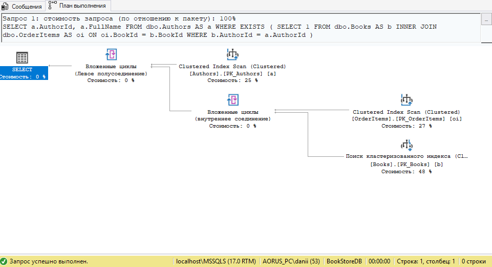
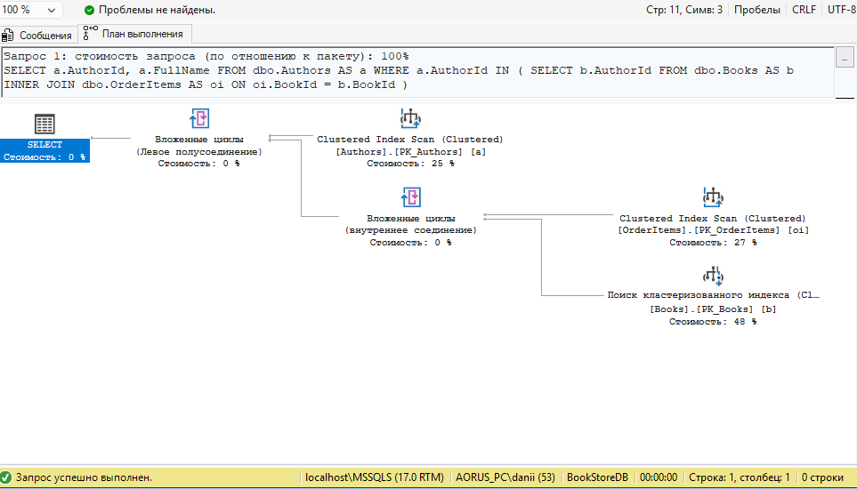
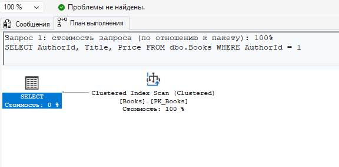
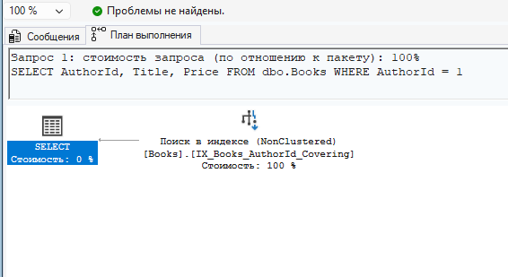

# Практическая работа №2

## Тема: T-SQL — управляющие конструкции, индексы и нормализация

## 1. Схема базы данных — 3NF

Предметная область — книжный интернет-магазин.

Схема разделяет авторов, книги, категории, клиентов, заказы и позиции заказов. Связь «книга — категория» реализована отдельной таблицей `BookCategories`, а связь «заказ — книга» — таблицей `OrderItems`.

```sql
CREATE DATABASE BookStoreDB;
GO

USE BookStoreDB;
GO

CREATE TABLE dbo.Authors
(
    AuthorId INT IDENTITY(1,1) NOT NULL,
    FullName NVARCHAR(200) NOT NULL,
    CONSTRAINT PK_Authors PRIMARY KEY CLUSTERED (AuthorId),
    CONSTRAINT UQ_Authors_FullName UNIQUE (FullName)
);
GO

CREATE TABLE dbo.Categories
(
    CategoryId INT IDENTITY(1,1) NOT NULL,
    CategoryName NVARCHAR(100) NOT NULL,
    CONSTRAINT PK_Categories PRIMARY KEY CLUSTERED (CategoryId),
    CONSTRAINT UQ_Categories_CategoryName UNIQUE (CategoryName)
);
GO

CREATE TABLE dbo.Books
(
    BookId INT IDENTITY(1,1) NOT NULL,
    AuthorId INT NOT NULL,
    Title NVARCHAR(300) NOT NULL,
    Price DECIMAL(10,2) NOT NULL,
    StockQty INT NOT NULL,
    CONSTRAINT PK_Books PRIMARY KEY CLUSTERED (BookId),
    CONSTRAINT FK_Books_Authors
        FOREIGN KEY (AuthorId) REFERENCES dbo.Authors(AuthorId),
    CONSTRAINT CK_Books_Price CHECK (Price > 0),
    CONSTRAINT CK_Books_StockQty CHECK (StockQty >= 0)
);
GO

CREATE TABLE dbo.BookCategories
(
    BookId INT NOT NULL,
    CategoryId INT NOT NULL,
    CONSTRAINT PK_BookCategories
        PRIMARY KEY CLUSTERED (BookId, CategoryId),
    CONSTRAINT FK_BookCategories_Books
        FOREIGN KEY (BookId) REFERENCES dbo.Books(BookId)
        ON DELETE CASCADE,
    CONSTRAINT FK_BookCategories_Categories
        FOREIGN KEY (CategoryId) REFERENCES dbo.Categories(CategoryId)
        ON DELETE CASCADE
);
GO

CREATE TABLE dbo.Customers
(
    CustomerId INT IDENTITY(1,1) NOT NULL,
    FullName NVARCHAR(200) NOT NULL,
    Email NVARCHAR(200) NOT NULL,
    City NVARCHAR(100) NOT NULL,
    CONSTRAINT PK_Customers PRIMARY KEY CLUSTERED (CustomerId),
    CONSTRAINT UQ_Customers_Email UNIQUE (Email)
);
GO

CREATE TABLE dbo.Orders
(
    OrderId INT IDENTITY(1,1) NOT NULL,
    CustomerId INT NOT NULL,
    OrderDate DATETIME2 NOT NULL
        CONSTRAINT DF_Orders_OrderDate DEFAULT SYSDATETIME(),
    Status NVARCHAR(20) NOT NULL,
    CONSTRAINT PK_Orders PRIMARY KEY NONCLUSTERED (OrderId),
    CONSTRAINT FK_Orders_Customers
        FOREIGN KEY (CustomerId) REFERENCES dbo.Customers(CustomerId),
    CONSTRAINT CK_Orders_Status
        CHECK (Status IN ('Pending', 'Shipped', 'Completed', 'Cancelled'))
);
GO

CREATE TABLE dbo.OrderItems
(
    OrderId INT NOT NULL,
    BookId INT NOT NULL,
    Quantity INT NOT NULL,
    UnitPrice DECIMAL(10,2) NOT NULL,
    CONSTRAINT PK_OrderItems
        PRIMARY KEY CLUSTERED (OrderId, BookId),
    CONSTRAINT FK_OrderItems_Orders
        FOREIGN KEY (OrderId) REFERENCES dbo.Orders(OrderId)
        ON DELETE CASCADE,
    CONSTRAINT FK_OrderItems_Books
        FOREIGN KEY (BookId) REFERENCES dbo.Books(BookId),
    CONSTRAINT CK_OrderItems_Quantity CHECK (Quantity > 0),
    CONSTRAINT CK_OrderItems_UnitPrice CHECK (UnitPrice > 0)
);
GO
```

### Обоснование 3NF

Каждая таблица описывает отдельную сущность. Повторяющиеся группы не используются, многозначные связи вынесены в таблицы `BookCategories` и `OrderItems`, а атрибуты зависят от ключей своих таблиц. Это позволяет избежать дублирования данных и аномалий обновления.

## 2. Заполнение тестовыми данными

Тестовый набор содержит 4 автора, 5 категорий, 8 книг, 6 клиентов, 8 заказов и несколько позиций в заказах с различными количествами.

```sql
INSERT INTO dbo.Authors (FullName)
VALUES
    (N'Лев Толстой'),
    (N'Фёдор Достоевский'),
    (N'Александр Пушкин'),
    (N'Антон Чехов');
GO

INSERT INTO dbo.Categories (CategoryName)
VALUES
    (N'Классика'),
    (N'Роман'),
    (N'Поэзия'),
    (N'Драма'),
    (N'Русская литература');
GO

INSERT INTO dbo.Books (AuthorId, Title, Price, StockQty)
VALUES
    (1, N'Война и мир', 1200.00, 15),
    (1, N'Анна Каренина', 950.00, 8),
    (2, N'Преступление и наказание', 850.00, 12),
    (2, N'Идиот', 780.00, 0),
    (3, N'Евгений Онегин', 650.00, 20),
    (3, N'Капитанская дочка', 550.00, 7),
    (4, N'Вишнёвый сад', 500.00, 10),
    (4, N'Палата №6', 450.00, 5);
GO

INSERT INTO dbo.BookCategories (BookId, CategoryId)
VALUES
    (1, 1), (1, 2), (1, 5),
    (2, 1), (2, 2), (2, 5),
    (3, 1), (3, 2), (3, 5),
    (4, 1), (4, 2), (4, 5),
    (5, 1), (5, 3), (5, 5),
    (6, 1), (6, 2), (6, 5),
    (7, 1), (7, 4), (7, 5),
    (8, 1), (8, 2), (8, 5);
GO

INSERT INTO dbo.Customers (FullName, Email, City)
VALUES
    (N'Иван Иванов', N'ivan@example.com', N'Москва'),
    (N'Анна Петрова', N'anna@example.com', N'Санкт-Петербург'),
    (N'Павел Сидоров', N'pavel@example.com', N'Москва'),
    (N'Мария Смирнова', N'maria@example.com', N'Казань'),
    (N'Елена Кузнецова', N'elena@example.com', N'Москва'),
    (N'Дмитрий Волков', N'dmitry@example.com', N'Новосибирск');
GO

INSERT INTO dbo.Orders (CustomerId, OrderDate, Status)
VALUES
    (1, '2026-01-10', N'Pending'),
    (2, '2026-01-12', N'Shipped'),
    (3, '2026-01-15', N'Completed'),
    (1, '2026-01-18', N'Pending'),
    (4, '2026-01-20', N'Completed'),
    (5, '2026-01-22', N'Pending'),
    (6, '2026-01-25', N'Cancelled'),
    (3, '2026-01-28', N'Pending');
GO

INSERT INTO dbo.OrderItems (OrderId, BookId, Quantity, UnitPrice)
VALUES
    (1, 1, 1, 1200.00),
    (1, 3, 2, 850.00),
    (1, 5, 1, 650.00),
    (2, 2, 1, 950.00),
    (2, 4, 1, 780.00),
    (3, 5, 2, 650.00),
    (3, 6, 1, 550.00),
    (4, 1, 1, 1200.00),
    (4, 7, 1, 500.00),
    (4, 8, 2, 450.00),
    (5, 3, 1, 850.00),
    (5, 6, 1, 550.00),
    (6, 2, 1, 950.00),
    (6, 5, 1, 650.00),
    (6, 7, 1, 500.00),
    (7, 4, 1, 780.00),
    (8, 1, 2, 1200.00),
    (8, 3, 1, 850.00);
GO
```

## 3. Задание 1 — индексы

```sql
CREATE CLUSTERED INDEX IX_Orders_OrderDate
ON dbo.Orders (OrderDate);
GO

CREATE NONCLUSTERED INDEX IX_Books_AuthorId_Covering
ON dbo.Books (AuthorId)
INCLUDE (Title, Price, StockQty);
GO

CREATE NONCLUSTERED INDEX IX_Orders_Pending
ON dbo.Orders (OrderDate, CustomerId)
WHERE Status = 'Pending';
GO
```

`IX_Orders_OrderDate` предназначен для работы с запросами по дате заказа. `IX_Books_AuthorId_Covering` содержит `AuthorId` как ключ и дополнительные поля через `INCLUDE`, поэтому запрос по автору может обслуживаться непосредственно из индекса. `IX_Orders_Pending` является фильтрованным индексом и содержит только заказы со статусом `Pending`.

> Для сравнения в задании 11 индекс `IX_Books_AuthorId_Covering` должен быть создан только после первого плана выполнения.

## 4. Задание 2 — TOP с WITH TIES

```sql
SELECT TOP (3) WITH TIES
    BookId,
    Title,
    Price
FROM dbo.Books
ORDER BY Price DESC;
```

`WITH TIES` добавляет строки, совпадающие по значению столбца сортировки с последней строкой выбранного набора.

## 5. Задание 3 — IF…ELSE + EXISTS

```sql
IF EXISTS
(
    SELECT 1
    FROM dbo.Books
    WHERE StockQty = 0
)
BEGIN
    PRINT N'Внимание: есть книги с нулевым остатком!';

    SELECT
        BookId,
        Title
    FROM dbo.Books
    WHERE StockQty = 0;
END
ELSE
BEGIN
    PRINT N'Все книги есть в наличии';
END;
```

## 6. Задание 4 — TRY…CATCH + THROW

```sql
BEGIN TRY
    INSERT INTO dbo.Orders
        (CustomerId, OrderDate, Status)
    VALUES
        (999, SYSDATETIME(), 'Pending');
END TRY
BEGIN CATCH
    SELECT
        ERROR_NUMBER() AS ErrorNumber,
        ERROR_MESSAGE() AS ErrorMessage;

    THROW;
END CATCH;
```

Проверяется нарушение внешнего ключа при попытке создать заказ для несуществующего клиента. Ошибка перехватывается в `CATCH` и затем повторно передаётся через `THROW`.

## 7. Задание 5 — OUTPUT при UPDATE

```sql
UPDATE dbo.Orders
SET Status = 'Shipped'
OUTPUT
    inserted.OrderId,
    deleted.Status AS OldStatus,
    inserted.Status AS NewStatus
WHERE Status = 'Pending';
```

`OUTPUT` выводит значения до и после изменения для затронутых строк.

## 8. Задание 6 — переменные и WHILE

```sql
DECLARE @threshold INT = 10;

WHILE @threshold > 0
BEGIN
    SELECT
        CONCAT(
            N'Порог: ',
            @threshold,
            N', книг меньше порога: ',
            COUNT(*)
        ) AS Result
    FROM dbo.Books
    WHERE StockQty < @threshold;

    SET @threshold -= 1;
END;
```

Цикл постепенно уменьшает значение `@threshold` и на каждой итерации подсчитывает количество книг с остатком меньше текущего порога.

## 9. Задание 7 — MERGE

```sql
CREATE TABLE #BookStockStaging
(
    BookId INT NOT NULL,
    NewStockQty INT NOT NULL,
    Title NVARCHAR(200) NOT NULL,
    AuthorId INT NOT NULL,
    Price DECIMAL(10,2) NOT NULL
);
GO

INSERT INTO #BookStockStaging
    (BookId, NewStockQty, Title, AuthorId, Price)
VALUES
    (1, 20, N'Война и мир', 1, 1200.00),
    (999, 7, N'Новая тестовая книга', 2, 780.00);
GO

SET IDENTITY_INSERT dbo.Books ON;

MERGE dbo.Books AS target
USING #BookStockStaging AS source
    ON target.BookId = source.BookId
WHEN MATCHED THEN
    UPDATE
    SET StockQty = source.NewStockQty
WHEN NOT MATCHED BY TARGET THEN
    INSERT
        (BookId, AuthorId, Title, Price, StockQty)
    VALUES
        (source.BookId, source.AuthorId, source.Title, source.Price, source.NewStockQty)
OUTPUT
    $action AS ActionName,
    inserted.BookId AS InsertedBookId,
    deleted.BookId AS DeletedBookId;

SET IDENTITY_INSERT dbo.Books OFF;
GO

DROP TABLE #BookStockStaging;
GO
```

В примере одна строка соответствует существующей книге и приводит к обновлению остатка, а строка с новым `BookId` приводит к вставке.

## 10. Задание 8 — EXISTS vs IN

### Вариант 1 — EXISTS

```sql
SELECT
    a.AuthorId,
    a.FullName
FROM dbo.Authors AS a
WHERE EXISTS
(
    SELECT 1
    FROM dbo.Books AS b
    INNER JOIN dbo.OrderItems AS oi
        ON oi.BookId = b.BookId
    WHERE b.AuthorId = a.AuthorId
);
```

### План выполнения `EXISTS`



### Вариант 2 — IN

```sql
SELECT
    a.AuthorId,
    a.FullName
FROM dbo.Authors AS a
WHERE a.AuthorId IN
(
    SELECT b.AuthorId
    FROM dbo.Books AS b
    INNER JOIN dbo.OrderItems AS oi
        ON oi.BookId = b.BookId
);
```

### План выполнения `IN`



### Сравнение

В данном запуске оба варианта получили практически одинаковый физический план выполнения. Это допустимый результат: SQL Server оптимизирует логические формы `EXISTS` и `IN` независимо от их синтаксического различия, поэтому при небольшом наборе данных визуальный план может совпасть.

## 11. Задание 9 — GO и область видимости

### Первый батч

```sql
DECLARE @city NVARCHAR(100) = N'Москва';

SELECT
    CustomerId,
    FullName,
    Email,
    City
FROM dbo.Customers
WHERE City = @city;
GO
```

### Второй батч

```sql
SELECT
    CustomerId,
    FullName,
    Email,
    City
FROM dbo.Customers
WHERE City = @city;
GO
```

Во втором батче переменная `@city` недоступна, потому что `GO` разделяет отправляемый в SQL Server скрипт на отдельные батчи, а локальная переменная существует только в пределах своего батча.

## 12. Задание 10 — клиенты, купившие книги из 3+ категорий в одном заказе

```sql
SELECT
    c.FullName,
    o.OrderId,
    COUNT(DISTINCT bc.CategoryId) AS UniqueCategoryCount
FROM dbo.Customers AS c
INNER JOIN dbo.Orders AS o
    ON o.CustomerId = c.CustomerId
INNER JOIN dbo.OrderItems AS oi
    ON oi.OrderId = o.OrderId
INNER JOIN dbo.Books AS b
    ON b.BookId = oi.BookId
INNER JOIN dbo.BookCategories AS bc
    ON bc.BookId = b.BookId
GROUP BY
    c.FullName,
    o.OrderId
HAVING COUNT(DISTINCT bc.CategoryId) >= 3
ORDER BY
    o.OrderId;
```

Благодаря нормализованной схеме категории хранятся как отдельные связи книги с категориями. Поэтому категории книг конкретного заказа можно получить через `JOIN` и посчитать через `COUNT(DISTINCT ...)`.

## 13. Задание 11 — Index Scan / Index Seek

### До создания покрывающего индекса

Индекс `IX_Books_AuthorId_Covering` удаляется перед первым запуском:

```sql
DROP INDEX IF EXISTS IX_Books_AuthorId_Covering
ON dbo.Books;
GO
```

После этого выполняется исходный запрос:

```sql
SELECT
    AuthorId,
    Title,
    Price
FROM dbo.Books
WHERE AuthorId = 1;
```

### Скриншот 11.1 — план до создания покрывающего индекса

На фактическом плане выполнения используется `Clustered Index Scan` по кластерному индексу `PK_Books`.



### После создания покрывающего индекса

```sql
CREATE NONCLUSTERED INDEX IX_Books_AuthorId_Covering
ON dbo.Books (AuthorId)
INCLUDE (Title, Price, StockQty);
GO
```

Тот же запрос выполняется повторно:

```sql
SELECT
    AuthorId,
    Title,
    Price
FROM dbo.Books
WHERE AuthorId = 1;
```

### Скриншот 11.2 — план после создания покрывающего индекса

После создания индекса фактический план использует `Index Seek (NonClustered)` по `IX_Books_AuthorId_Covering`.



### Вывод по заданию 11

До создания покрывающего индекса SQL Server выполнял сканирование кластерного индекса. После создания индекса по `AuthorId` с включёнными `Title`, `Price` и `StockQty` запрос получил возможность использовать точечный поиск в некластерном индексе.

## 14. Итоговый вывод

В работе была создана нормализованная до 3NF база данных книжного интернет-магазина. Реализованы таблицы сущностей и промежуточные таблицы для связей. Выполнены задания по индексам, `TOP WITH TIES`, `IF…ELSE`, `EXISTS`, `TRY…CATCH`, `THROW`, `OUTPUT`, `WHILE`, `MERGE`, сравнению `EXISTS` и `IN`, области видимости переменных при использовании `GO`, а также анализу плана выполнения до и после создания покрывающего индекса.
