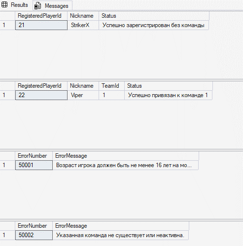
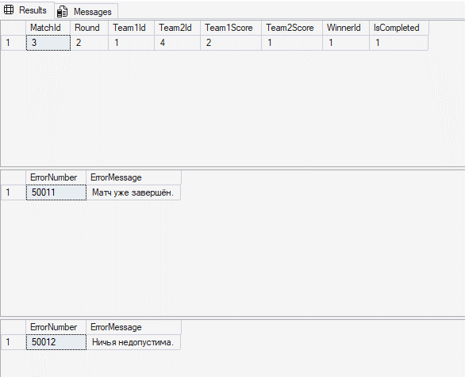
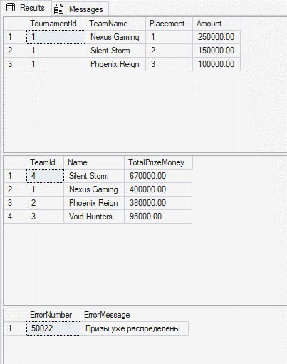
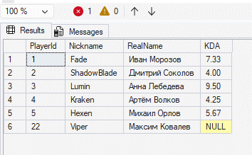
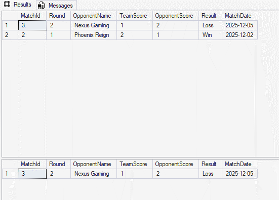
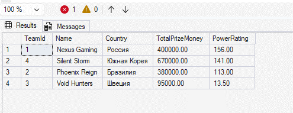
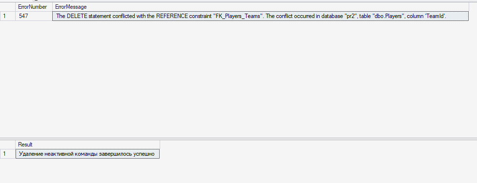
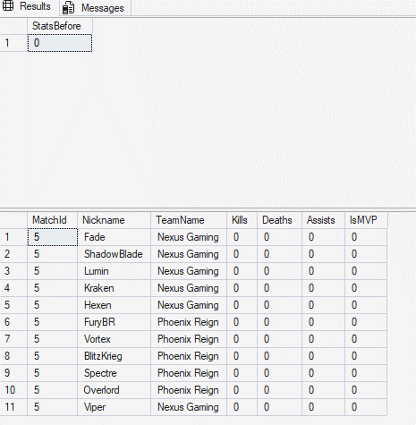
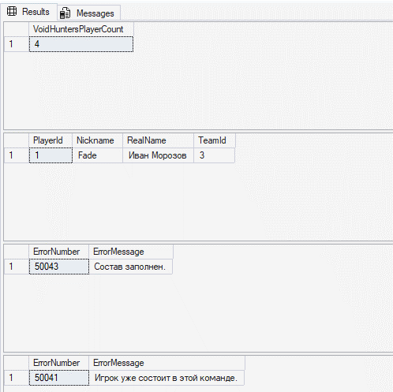

## 1. Хранимые процедуры (Stored Procedures)
## Регистрация игрока (RegisterPlayer)
```sql
CREATE OR ALTER PROCEDURE dbo.RegisterPlayer
@Nickname   NVARCHAR(50),
@RealName   NVARCHAR(100),
@Country    NVARCHAR(50),
@BirthDate  DATE,
@TeamId     INT = NULL,
@PlayerId   INT = NULL OUTPUT
AS
BEGIN
    SET NOCOUNT ON;
    IF DATEADD(year, 16, @BirthDate) > CAST(GETDATE() AS DATE)
    BEGIN
        THROW 50001, N'Возраст игрока должен быть не менее 16 лет на момент регистрации.', 1;
    END;
    IF @TeamId IS NOT NULL
    BEGIN
        IF NOT EXISTS (SELECT 1 FROM dbo.Teams WHERE TeamId = @TeamId AND IsActive = 1)
        BEGIN
            THROW 50002, N'Указанная команда не существует или неактивна.', 1;
        END;
    END;
    INSERT INTO dbo.Players (Nickname, RealName, Country, BirthDate, TeamId)
    VALUES (@Nickname, @RealName, @Country, @BirthDate, @TeamId);
    SET @PlayerId = SCOPE_IDENTITY();
END;
GO
```
Тесты:
```sql
DECLARE @NewId1 INT;
EXEC dbo.RegisterPlayer
@Nickname = N'StrikerX',
@RealName = N'Илья Смирнов',
@Country = N'Россия',
@BirthDate = '2004-06-15',
@TeamId = NULL,
    @PlayerId = @NewId1 OUTPUT;
SELECT @NewId1 AS RegisteredPlayerId, N'StrikerX' AS Nickname, N'Registered as free agent' AS Status;
DECLARE @NewId2 INT;
EXEC dbo.RegisterPlayer
@Nickname = N'Viper',
@RealName = N'Максим Ковалев',
@Country = N'Россия',
@BirthDate = '2005-11-20',
@TeamId = 1,
    @PlayerId = @NewId2 OUTPUT;
SELECT @NewId2 AS RegisteredPlayerId, N'Viper' AS Nickname, 1 AS TeamId, N'Successfully moved to team 1' AS Status;
BEGIN TRY
    DECLARE @ErrId1 INT;
    EXEC dbo.RegisterPlayer
@Nickname = N'YoungKid',
@RealName = N'Даниил Попов',
@Country = N'Россия',
@BirthDate = '2015-01-01',
        @PlayerId = @ErrId1 OUTPUT;
END TRY
BEGIN CATCH
    SELECT ERROR_NUMBER() AS ErrorNumber, ERROR_MESSAGE() AS ErrorMessage;
END CATCH;
BEGIN TRY
    DECLARE @ErrId2 INT;
    EXEC dbo.RegisterPlayer
@Nickname = N'GhostRider',
@RealName = N'Сергей Васильев',
@Country = N'США',
@BirthDate = '2000-01-01',
@TeamId = 5,
        @PlayerId = @ErrId2 OUTPUT;
END TRY
BEGIN CATCH
    SELECT ERROR_NUMBER() AS ErrorNumber, ERROR_MESSAGE() AS ErrorMessage;
END CATCH;
GO
```
## Результаты выполнения тестов:


## Завершение матча (CompleteMatch)
```sql
CREATE OR ALTER PROCEDURE dbo.CompleteMatch
@MatchId    INT,
@Team1Score INT,
@Team2Score INT
AS
BEGIN
    SET NOCOUNT ON;
    SET XACT_ABORT ON;
    BEGIN TRY
        BEGIN TRANSACTION;
        -- 1. Проверка на ничью: в турнире ничьи не допускаются
        IF @Team1Score = @Team2Score
        BEGIN
            THROW 50012, N'Ничья недопустима.', 1;
        END;
        DECLARE @Team1Id INT, @Team2Id INT, @IsCompleted BIT;
        -- 2. Получение данных матча с эксклюзивной блокировкой
SELECT
@Team1Id = Team1Id,
@Team2Id = Team2Id,
@IsCompleted = IsCompleted
        FROM dbo.Matches WITH (UPDLOCK, HOLDLOCK)
        WHERE MatchId = @MatchId;
        -- Проверка существования матча
        IF @Team1Id IS NULL
        BEGIN
            THROW 50010, N'Матч с указанным ID не найден.', 1;
        END;
        -- Проверка, что матч не был завершён ранее
        IF @IsCompleted = 1
        BEGIN
            THROW 50011, N'Матч уже завершён.', 1;
        END;
        -- 3. Определение идентификатора победителя
        DECLARE @WinnerId INT;
        IF @Team1Score > @Team2Score
            SET @WinnerId = @Team1Id;
        ELSE
            SET @WinnerId = @Team2Id;
        -- 4. Обновление записи матча
        UPDATE dbo.Matches
        SET Team1Score  = @Team1Score,
Team2Score  = @Team2Score,
WinnerId    = @WinnerId,
IsCompleted = 1
        WHERE MatchId = @MatchId;
        COMMIT TRANSACTION;
    END TRY
    BEGIN CATCH
        IF @@TRANCOUNT > 0
            ROLLBACK TRANSACTION;
        THROW;
    END CATCH;
END;
GO
```
## Тестовые вызовы процедуры CompleteMatch:
```sql
-- Тест 2.1: Успешное завершение матча 3 (Финал: Team 1 Nexus Gaming vs Team 4 Silent Storm)
EXEC dbo.CompleteMatch
@MatchId = 3,
@Team1Score = 2,
    @Team2Score = 1;
-- Проверка обновлённого состояния матча 3
SELECT MatchId, Round, Team1Id, Team2Id, Team1Score, Team2Score, WinnerId, IsCompleted
FROM dbo.Matches
WHERE MatchId = 3;
-- Тест 2.2: Попытка повторного завершения уже закрытого матча 3 (ошибка THROW 50011)
BEGIN TRY
    EXEC dbo.CompleteMatch
@MatchId = 3,
@Team1Score = 2,
        @Team2Score = 0;
END TRY
BEGIN CATCH
    SELECT ERROR_NUMBER() AS ErrorNumber, ERROR_MESSAGE() AS ErrorMessage;
END CATCH;
-- Тест 2.3: Попытка завершить матч 4 с равным счётом (ошибка THROW 50012)
BEGIN TRY
    EXEC dbo.CompleteMatch
@MatchId = 4,
@Team1Score = 1,
        @Team2Score = 1;
END TRY
BEGIN CATCH
    SELECT ERROR_NUMBER() AS ErrorNumber, ERROR_MESSAGE() AS ErrorMessage;
END CATCH;
GO
```
## Результаты выполнения тестов:

## Процедура 3 (сложная): Распределение призового фонда (DistributePrizes)
## 1. Проверка статуса турнира (должен быть Completed).
## 2. Проверка повторного вызова: если призы уже начислены в PrizeDistributions, процедура возвращает ошибку.
## 3. Поиск финального матча и матча за 3-е место среди завершенных игр максимального раунда.
## 4. Определение призеров: победитель финала занимает 1-е место, проигравший - 2-е, а победитель утешительного матча - 3-е.
## 5. Расчет долей призового фонда: 50% за 1-е место, 30% за 2-е и 20% за 3-е.
## 6. Сохранение записей в PrizeDistributions и начисление сумм в TotalPrizeMoney таблицы Teams внутри общей транзакции.
```sql
CREATE OR ALTER PROCEDURE dbo.DistributePrizes
@TournamentId INT
AS
BEGIN
    SET NOCOUNT ON;
    SET XACT_ABORT ON;
    BEGIN TRY
        BEGIN TRANSACTION;
        DECLARE @Status NVARCHAR(20);
        DECLARE @PrizePool DECIMAL(12,2);
        -- 1. Проверка существования и статуса турнира
SELECT
@Status = Status,
@PrizePool = PrizePool
        FROM dbo.Tournaments WITH (UPDLOCK, HOLDLOCK)
        WHERE TournamentId = @TournamentId;
        IF @Status IS NULL
        BEGIN
            THROW 50020, N'Турнир с указанным ID не найден.', 1;
        END;
        IF @Status <> 'Completed'
        BEGIN
            THROW 50021, N'Турнир не имеет статуса Completed. Распределение невозможно.', 1;
        END;
        -- 2. Проверка: не распределялись ли призы ранее
        IF EXISTS (SELECT 1 FROM dbo.PrizeDistributions WHERE TournamentId = @TournamentId)
        BEGIN
            THROW 50022, N'Призы уже распределены.', 1;
        END;
        -- 3. Определение максимального раунда
        DECLARE @MaxRound INT;
        SELECT @MaxRound = MAX(Round)
        FROM dbo.Matches
        WHERE TournamentId = @TournamentId AND IsCompleted = 1;
        IF @MaxRound IS NULL
        BEGIN
            THROW 50023, N'В турнире отсутствуют завершённые матчи.', 1;
        END;
        -- Поиск финального матча и матча за 3-е место в максимальном раунде
        DECLARE @FinalMatchId INT = NULL;
        DECLARE @ThirdPlaceMatchId INT = NULL;
        IF (SELECT COUNT(*) FROM dbo.Matches WHERE TournamentId = @TournamentId AND Round = @MaxRound AND IsCompleted = 1) = 1
        BEGIN
            SELECT @FinalMatchId = MatchId
            FROM dbo.Matches
            WHERE TournamentId = @TournamentId AND Round = @MaxRound AND IsCompleted = 1;
            SELECT TOP 1 @ThirdPlaceMatchId = MatchId
            FROM dbo.Matches
            WHERE TournamentId = @TournamentId AND MatchId <> @FinalMatchId AND IsCompleted = 1
            ORDER BY Round DESC;
        END
        ELSE
        BEGIN
            -- Финальный матч: команды-победители предыдущего раунда
            SELECT @FinalMatchId = m.MatchId
            FROM dbo.Matches m
            WHERE m.TournamentId = @TournamentId
AND m.Round = @MaxRound
AND m.IsCompleted = 1
AND (
```
m.Team1Id IN (SELECT WinnerId FROM dbo.Matches WHERE TournamentId = @TournamentId AND Round = @MaxRound - 1)
```sql
AND m.Team2Id IN (SELECT WinnerId FROM dbo.Matches WHERE TournamentId = @TournamentId AND Round = @MaxRound - 1)
              );
            -- Если не удалось вычислить по полуфиналам, берём первый завершённый матч раунда
            IF @FinalMatchId IS NULL
            BEGIN
                SELECT TOP 1 @FinalMatchId = MatchId
                FROM dbo.Matches
                WHERE TournamentId = @TournamentId AND Round = @MaxRound AND IsCompleted = 1
                ORDER BY MatchId ASC;
            END;
-- Второй матч максимального раунда: матч за 3-е место
            SELECT TOP 1 @ThirdPlaceMatchId = MatchId
            FROM dbo.Matches
            WHERE TournamentId = @TournamentId
AND Round = @MaxRound
AND IsCompleted = 1
              AND MatchId <> @FinalMatchId;
        END;
        IF @FinalMatchId IS NULL
        BEGIN
            THROW 50024, N'Не удалось определить финальный матч турнира.', 1;
        END;
        -- 4. Определение топ-3 команд
        DECLARE @FirstPlaceTeamId INT;
        DECLARE @SecondPlaceTeamId INT;
SELECT
@FirstPlaceTeamId = WinnerId,
@SecondPlaceTeamId = CASE WHEN WinnerId = Team1Id THEN Team2Id ELSE Team1Id END
        FROM dbo.Matches
        WHERE MatchId = @FinalMatchId;
        DECLARE @ThirdPlaceTeamId INT = NULL;
        IF @ThirdPlaceMatchId IS NOT NULL
        BEGIN
            SELECT @ThirdPlaceTeamId = WinnerId
            FROM dbo.Matches
            WHERE MatchId = @ThirdPlaceMatchId;
        END;
        -- 5. Расчёт призовых долей (50%, 30%, 20%)
        DECLARE @Prize1 DECIMAL(12,2) = ROUND(@PrizePool * 0.50, 2);
        DECLARE @Prize2 DECIMAL(12,2) = ROUND(@PrizePool * 0.30, 2);
        DECLARE @Prize3 DECIMAL(12,2) = ROUND(@PrizePool * 0.20, 2);
        -- Внесение 1-го места
        INSERT INTO dbo.PrizeDistributions (TournamentId, TeamId, Placement, Amount)
        VALUES (@TournamentId, @FirstPlaceTeamId, 1, @Prize1);
        UPDATE dbo.Teams
        SET TotalPrizeMoney = TotalPrizeMoney + @Prize1
        WHERE TeamId = @FirstPlaceTeamId;
        -- Внесение 2-го места
        INSERT INTO dbo.PrizeDistributions (TournamentId, TeamId, Placement, Amount)
        VALUES (@TournamentId, @SecondPlaceTeamId, 2, @Prize2);
        UPDATE dbo.Teams
        SET TotalPrizeMoney = TotalPrizeMoney + @Prize2
        WHERE TeamId = @SecondPlaceTeamId;
        -- Внесение 3-го места (если имеется)
        IF @ThirdPlaceTeamId IS NOT NULL
        BEGIN
            INSERT INTO dbo.PrizeDistributions (TournamentId, TeamId, Placement, Amount)
            VALUES (@TournamentId, @ThirdPlaceTeamId, 3, @Prize3);
            UPDATE dbo.Teams
            SET TotalPrizeMoney = TotalPrizeMoney + @Prize3
            WHERE TeamId = @ThirdPlaceTeamId;
        END;
        COMMIT TRANSACTION;
    END TRY
    BEGIN CATCH
        IF @@TRANCOUNT > 0
            ROLLBACK TRANSACTION;
        THROW;
    END CATCH;
END;
GO
```
## Тестовые вызовы процедуры DistributePrizes:
```sql
-- Подготовка данных: завершаем матч 4 (за 3-е место между Void Hunters и Phoenix Reign)
EXEC dbo.CompleteMatch @MatchId = 4, @Team1Score = 0, @Team2Score = 2; -- Phoenix победил 2:0
-- Переводим турнир 1 в статус 'Completed'
UPDATE dbo.Tournaments
SET Status = 'Completed'
WHERE TournamentId = 1;
-- Тест 3.1: Успешный вызов процедуры распределения призов
EXEC dbo.DistributePrizes @TournamentId = 1;
-- Проверка таблицы распределения призов
SELECT
```
pd.TournamentId,
t.Name AS TeamName,
pd.Placement,
pd.Amount
```sql
FROM dbo.PrizeDistributions pd
JOIN dbo.Teams t ON pd.TeamId = t.TeamId
WHERE pd.TournamentId = 1
ORDER BY pd.Placement ASC;
-- Проверка обновлённого общего призового фонда команд
SELECT TeamId, Name, TotalPrizeMoney
FROM dbo.Teams
WHERE TeamId IN (1, 4, 2, 3)
ORDER BY TotalPrizeMoney DESC;
-- Тест 3.2: Попытка повторного вызова (проверка ошибки «Призы уже распределены»)
BEGIN TRY
    EXEC dbo.DistributePrizes @TournamentId = 1;
END TRY
BEGIN CATCH
    SELECT ERROR_NUMBER() AS ErrorNumber, ERROR_MESSAGE() AS ErrorMessage;
END CATCH;
GO
```
## Результаты выполнения тестов:

## 2. Пользовательские функции (User-Defined Functions)
## KDA игрока (GetPlayerKDA)

```sql
CREATE OR ALTER FUNCTION dbo.GetPlayerKDA (@PlayerId INT)
RETURNS DECIMAL(10, 2)
AS
BEGIN
    DECLARE @KDA DECIMAL(10, 2);
    -- Если у игрока нет записей матчей, возвращаем NULL
    IF NOT EXISTS (SELECT 1 FROM dbo.PlayerMatchStats WHERE PlayerId = @PlayerId)
    BEGIN
        RETURN NULL;
    END;
    -- Расчёт среднего показателя KDA по всем матчам с защитой от деления на ноль
    SELECT @KDA = AVG(
```
CAST(Kills + Assists AS DECIMAL(10, 2)) /
CAST(CASE WHEN Deaths = 0 THEN 1 ELSE Deaths END AS DECIMAL(10, 2))
)
```sql
    FROM dbo.PlayerMatchStats
    WHERE PlayerId = @PlayerId;
    RETURN @KDA;
END;
GO
```
Тестовый вызов: запрос с выводом никнеймов, реальных имен и KDA всех игроков команды 1 (Nexus Gaming):
```sql
SELECT
```
p.PlayerId,
p.Nickname,
p.RealName,
dbo.GetPlayerKDA(p.PlayerId) AS KDA
```sql
FROM dbo.Players p
WHERE p.TeamId = 1;
GO
```
Результат выполнения запроса:

## История матчей команды (GetTeamMatchHistory)
```sql
CREATE OR ALTER FUNCTION dbo.GetTeamMatchHistory
```
(
```sql
@TeamId INT,
@GamesBack INT = NULL
```
)

```sql
RETURNS TABLE
AS
RETURN
```
(
```sql
    SELECT TOP (COALESCE(@GamesBack, 2147483647))
```
m.MatchId,
m.Round,
```sql
CASE
WHEN m.Team1Id = @TeamId THEN t2.Name
            ELSE t1.Name
        END AS OpponentName,
CASE
WHEN m.Team1Id = @TeamId THEN m.Team1Score
            ELSE m.Team2Score
        END AS TeamScore,
CASE
WHEN m.Team1Id = @TeamId THEN m.Team2Score
            ELSE m.Team1Score
        END AS OpponentScore,
CASE
WHEN m.IsCompleted = 0 THEN 'Pending'
WHEN m.WinnerId = @TeamId THEN 'Win'
            ELSE 'Loss'
        END AS Result,
```
m.MatchDate
```sql
    FROM dbo.Matches m
    JOIN dbo.Teams t1 ON m.Team1Id = t1.TeamId
    JOIN dbo.Teams t2 ON m.Team2Id = t2.TeamId
    WHERE m.Team1Id = @TeamId OR m.Team2Id = @TeamId
    ORDER BY m.MatchDate DESC, m.MatchId DESC
);
GO
```
## Тестовые вызовы функции GetTeamMatchHistory:
```sql
-- Тест 2.1: Вызов для команды 4 (Silent Storm): вывод всех матчей (@GamesBack = NULL)
SELECT *
FROM dbo.GetTeamMatchHistory(4, NULL);
-- Тест 2.2: Вызов для команды 4 с ограничением на 1 последний матч (@GamesBack = 1)
SELECT *
FROM dbo.GetTeamMatchHistory(4, 1);
GO
```
## Результаты выполнения вызовов:

Рейтинг силы команды (GetTeamPowerRating)
Скалярная функция с привязкой к схеме (WITH SCHEMABINDING) рассчитывает рейтинг силы команды по формуле:
```sql
Rating = WinRate * 100 + (TotalPrizeMoney / 10000) + (SponsorBudget / 5000)
```
В расчете WinRate - доля побед в завершенных матчах, TotalPrizeMoney берется из таблицы Teams, а SponsorBudget суммирует взносы из таблицы TeamSponsors.

```sql
CREATE OR ALTER FUNCTION dbo.GetTeamPowerRating (@TeamId INT)
RETURNS DECIMAL(12, 2)
WITH SCHEMABINDING
AS
BEGIN
    DECLARE @TotalPrizeMoney DECIMAL(12, 2) = 0.0;
    DECLARE @SponsorBudget DECIMAL(12, 2) = 0.0;
    DECLARE @TotalCompletedMatches INT = 0;
    DECLARE @Wins INT = 0;
    DECLARE @WinRate DECIMAL(10, 4) = 0.0;
    DECLARE @Rating DECIMAL(12, 2) = 0.0;
    -- 1. Призовые из таблицы Teams
    SELECT @TotalPrizeMoney = ISNULL(TotalPrizeMoney, 0.0)
    FROM dbo.Teams
    WHERE TeamId = @TeamId;
    -- 2. Суммарный бюджет спонсоров из TeamSponsors
    SELECT @SponsorBudget = ISNULL(SUM(ContributionAmount), 0.0)
    FROM dbo.TeamSponsors
    WHERE TeamId = @TeamId;
    -- 3. Подсчёт завершённых матчей и побед
SELECT
@TotalCompletedMatches = COUNT_BIG(1),
@Wins = ISNULL(SUM(CASE WHEN WinnerId = @TeamId THEN 1 ELSE 0 END), 0)
    FROM dbo.Matches
    WHERE IsCompleted = 1
      AND (Team1Id = @TeamId OR Team2Id = @TeamId);
    -- 4. Вычисление WinRate (доля от 0.0 до 1.0)
    IF @TotalCompletedMatches > 0
    BEGIN
        SET @WinRate = CAST(@Wins AS DECIMAL(10, 4)) / CAST(@TotalCompletedMatches AS DECIMAL(10, 4));
    END;
    -- 5. Расчёт комплексного рейтинга
    SET @Rating = CAST(
```
(@WinRate * 100.0) +
(@TotalPrizeMoney / 10000.0) +
(@SponsorBudget / 5000.0)

```sql
        AS DECIMAL(12, 2)
    );
    RETURN @Rating;
END;
GO
```
Тестовый вызов: запрос, выводящий рейтинг всех активных команд платформы в порядке убывания:
```sql
SELECT
```
t.TeamId,
t.Name,
t.Country,
t.TotalPrizeMoney,
dbo.GetTeamPowerRating(t.TeamId) AS PowerRating
```sql
FROM dbo.Teams t
WHERE t.IsActive = 1
ORDER BY PowerRating DESC;
GO
```
Результат выполнения запроса:

## 3. Триггеры (Triggers)
## Защита от удаления активной команды (trg_Teams_PreventActiveDelete)
Триггер AFTER DELETE на таблице Teams проверяет удаляемые строки. Если среди них есть активная команда (IsActive = 1), транзакция откатывается с ошибкой. Неактивные команды удаляются без ограничений.
```sql
CREATE OR ALTER TRIGGER dbo.trg_Teams_PreventActiveDelete
ON dbo.Teams
```
AFTER DELETE
```sql
AS
BEGIN
    SET NOCOUNT ON;
    IF EXISTS (SELECT 1 FROM deleted WHERE IsActive = 1)
    BEGIN
        ROLLBACK TRANSACTION;
        THROW 50030, N'Нельзя удалить активную команду. Сначала деактивируйте её.', 1;
    END;
END;
GO
```
## Тестирование триггера:
```sql
-- Тест 1.1: Попытка удаления активной команды (TeamId = 1, Nexus Gaming, IsActive = 1)
BEGIN TRY
    DELETE FROM dbo.Teams WHERE TeamId = 1;
END TRY
BEGIN CATCH
    SELECT ERROR_NUMBER() AS ErrorNumber, ERROR_MESSAGE() AS ErrorMessage;
END CATCH;
-- Тест 1.2: Успешное удаление неактивной команды (создаём временную неактивную команду)
INSERT INTO dbo.Teams (Name, Country, FoundedDate, TotalPrizeMoney, IsActive)
VALUES (N'Old Inactive Squad', N'Германия', '2020-01-01', 0, 0);
DECLARE @InactiveTeamId INT = SCOPE_IDENTITY();
-- Удаление неактивной команды (триггер не блокирует)
DELETE FROM dbo.Teams WHERE TeamId = @InactiveTeamId;
SELECT N'Удаление неактивной команды завершилось успешно' AS Result;
GO
```
## Результаты выполнения тестов:


## Авто-создание статистики при завершении матча (trg_Matches_AfterUpdate_InitStats)
Триггер AFTER UPDATE на таблице Matches срабатывает при закрытии матча, когда поле IsCompleted меняется с 0 на 1. Для игроков обеих команд создаются записи с нулевой статистикой в PlayerMatchStats, если строки для них еще не были добавлены ранее.
```sql
CREATE OR ALTER TRIGGER dbo.trg_Matches_AfterUpdate_InitStats
ON dbo.Matches
```
AFTER UPDATE
```sql
AS
BEGIN
    SET NOCOUNT ON;
    -- Проверяем, что обновлялась именно колонка IsCompleted
    IF NOT UPDATE(IsCompleted)
        RETURN;
    -- Вставляем заглушки статистики для игроков обеих команд завершившегося матча
    INSERT INTO dbo.PlayerMatchStats (PlayerId, MatchId, Kills, Deaths, Assists, IsMVP)
SELECT
```
p.PlayerId,
i.MatchId,
0 AS Kills,
0 AS Deaths,
0 AS Assists,
0 AS IsMVP
```sql
    FROM inserted i
    JOIN deleted d ON i.MatchId = d.MatchId
    JOIN dbo.Players p ON p.TeamId IN (i.Team1Id, i.Team2Id)
    WHERE d.IsCompleted = 0
AND i.IsCompleted = 1
      -- Исключаем дублирование записей
AND NOT EXISTS (
          SELECT 1
          FROM dbo.PlayerMatchStats pms
          WHERE pms.PlayerId = p.PlayerId
AND pms.MatchId = i.MatchId
      );
END;
GO
```
## Тестирование триггера:
```sql
-- Создаём новый тестовый матч между Team 1 (Nexus) и Team 2 (Phoenix) в статусе IsCompleted = 0
INSERT INTO dbo.Matches (TournamentId, Round, Team1Id, Team2Id, MatchDate, IsCompleted)
VALUES (1, 3, 1, 2, '2025-12-10', 0);
DECLARE @TestMatchId INT = SCOPE_IDENTITY();
-- Проверяем: до завершения матча записей статистики нет
SELECT COUNT(*) AS StatsBefore FROM dbo.PlayerMatchStats WHERE MatchId = @TestMatchId;
-- Завершаем матч через UPDATE поля IsCompleted (с 0 на 1)
UPDATE dbo.Matches
SET Team1Score = 2, Team2Score = 0, WinnerId = 1, IsCompleted = 1
WHERE MatchId = @TestMatchId;
-- Проверяем: триггер автоматически сгенерировал 10 записей (по 5 игроков для каждой команды)
SELECT
```
pms.MatchId,
p.Nickname,
t.Name AS TeamName,
pms.Kills,
pms.Deaths,
pms.Assists,
pms.IsMVP
```sql
FROM dbo.PlayerMatchStats pms
JOIN dbo.Players p ON pms.PlayerId = p.PlayerId
JOIN dbo.Teams t ON p.TeamId = t.TeamId
WHERE pms.MatchId = @TestMatchId;
GO
```
## Результаты выполнения тестов:

## INSTEAD OF на представлении (трансфер игрока)
Представление vw_PlayerTransfers объединяет данные игроков и команд, а триггер INSTEAD OF UPDATE управляет переходами игроков:
Правила трансфера:
## 1. Новая команда должна существовать и быть активной (IsActive = 1).
## 2. В составе целевой команды не может быть больше 5 игроков, иначе возвращается ошибка.
## 3. Запрещен перевод игрока в ту же команду, где он уже состоит.
## 4. Обновление применяется только к полю TeamId в таблице Players, остальные изменения игнорируются.
```sql
-- Представление игроков с информацией о командах
CREATE OR ALTER VIEW dbo.vw_PlayerTransfers
AS
SELECT
```
p.PlayerId,
p.Nickname,
p.RealName,
p.Country AS PlayerCountry,
p.BirthDate,
p.TeamId,
t.Name AS TeamName,
t.Country AS TeamCountry,
t.IsActive AS TeamIsActive
```sql
FROM dbo.Players p
LEFT JOIN dbo.Teams t ON p.TeamId = t.TeamId;
GO
-- INSTEAD OF UPDATE триггер на представлении
CREATE OR ALTER TRIGGER dbo.trg_vw_PlayerTransfers_Update
ON dbo.vw_PlayerTransfers
```
## INSTEAD OF UPDATE
```sql
AS
BEGIN
    SET NOCOUNT ON;
    -- 1. Запрет перехода в ту же команду
    IF EXISTS (
        SELECT 1
        FROM inserted i
        JOIN deleted d ON i.PlayerId = d.PlayerId
        WHERE (i.TeamId = d.TeamId) OR (i.TeamId IS NULL AND d.TeamId IS NULL)
```
)
```sql
    BEGIN
        ROLLBACK TRANSACTION;
        THROW 50041, N'Игрок уже состоит в этой команде.', 1;
    END;
    -- 2. Проверка существования и активности новой команды
    IF EXISTS (
        SELECT 1
        FROM inserted i
        WHERE i.TeamId IS NOT NULL
AND NOT EXISTS (
              SELECT 1
              FROM dbo.Teams t
              WHERE t.TeamId = i.TeamId AND t.IsActive = 1
```
)
)
```sql
    BEGIN
        ROLLBACK TRANSACTION;
        THROW 50042, N'Новая команда не существует или неактивна.', 1;
    END;
    -- 3. Проверка лимита игроков в команде (максимум 5 игроков в составе)
    IF EXISTS (
        SELECT i.TeamId
        FROM inserted i
CROSS APPLY (
            SELECT COUNT(*) AS CurrentCount
            FROM dbo.Players p
            WHERE p.TeamId = i.TeamId
```
) cnt
```sql
        WHERE i.TeamId IS NOT NULL
        GROUP BY i.TeamId, cnt.CurrentCount
        HAVING cnt.CurrentCount >= 5 OR (cnt.CurrentCount + COUNT(*)) > 5
```
)
```sql
    BEGIN
        ROLLBACK TRANSACTION;
        THROW 50043, N'Состав заполнен.', 1;
    END;
    -- 4. Обновление исключительно TeamId в таблице Players
    UPDATE p
    SET p.TeamId = i.TeamId
    FROM dbo.Players p
    JOIN inserted i ON p.PlayerId = i.PlayerId;
END;
GO
```
## Тестирование сценариев трансфера (согласно заданию):
В исходных данных у всех команд заняты все 5 слотов. Чтобы проверить успешный перевод, сначала освобождаем место в Void Hunters (TeamId = 3), отвязав игрока Dusk. После этого переводим Fade в Void Hunters и следом проверяем ошибку при попытке перевода в заполненный состав Silent Storm.
```sql
-- Шаг 1: Освобождаем один слот в Void Hunters (TeamId = 3), отзаявив игрока Dusk (TeamId = NULL)
UPDATE dbo.Players SET TeamId = NULL WHERE Nickname = N'Dusk';
-- Проверяем количество игроков в Void Hunters: теперь их 4 (есть место)
SELECT COUNT(*) AS VoidHuntersPlayerCount FROM dbo.Players WHERE TeamId = 3;
-- Тест 3.1: Успешный трансфер Fade (PlayerId = 1) из Nexus Gaming (TeamId = 1) в Void Hunters (TeamId = 3)
-- Также пробуем обновить RealName, чтобы доказать, что обновляется только TeamId
UPDATE dbo.vw_PlayerTransfers
SET TeamId = 3, RealName = N'Попытка подмены имени'
WHERE PlayerId = 1;
-- Проверяем игрока в таблице Players: TeamId изменился на 3, RealName остался 'Иван Морозов'
SELECT PlayerId, Nickname, RealName, TeamId FROM dbo.Players WHERE PlayerId = 1;
-- Тест 3.2: Попытка трансфера игрока Fade в Silent Storm (TeamId = 4), где уже 5 игроков
BEGIN TRY
    UPDATE dbo.vw_PlayerTransfers
    SET TeamId = 4
    WHERE PlayerId = 1;
END TRY
BEGIN CATCH
    SELECT ERROR_NUMBER() AS ErrorNumber, ERROR_MESSAGE() AS ErrorMessage;
END CATCH;
-- Тест 3.3: Попытка перевести игрока в ту же самую команду (Fade уже в TeamId = 3)
BEGIN TRY
    UPDATE dbo.vw_PlayerTransfers
    SET TeamId = 3
    WHERE PlayerId = 1;
END TRY
BEGIN CATCH
    SELECT ERROR_NUMBER() AS ErrorNumber, ERROR_MESSAGE() AS ErrorMessage;
END CATCH;
GO
```
## Результаты выполнения тестов:

