# 1. Таблица обоснований архитектурных решений (Требование 2 отчёта)

В таблице указан выбранный тип программируемого объекта (триггер, процедура или функция) и ограничения альтернатив.

| № | Бизнес-требование | Выбранный объект | Обоснование выбора | Ограничения альтернатив |
| --- | --- | --- | --- | --- |
| 1 | Автоматический журнал статусов аренды | Триггер | Каждое изменение статуса аренды должно записываться в журнал, включая случаи, вызванные прямыми запросами INSERT и UPDATE. Триггер работает в той же транзакции и обращается к псевдотаблицам deleted и inserted. | Функция не изменяет данные и не может добавить запись в журнал. |
| 2 | Расчёт примерного запаса хода | Скалярная функция | Функция вычисляет значение без изменения данных. Её можно вызывать в SELECT, WHERE, ORDER BY и аналитических отчётах. | Процедуру нельзя вызвать внутри SELECT или WHERE. |
| 3 | Оформление аренды авто | Хранимая процедура | Процедура принимает входные параметры, проверяет статус профиля водителя, срок действия удостоверения, заряд не ниже 30% и статус автомобиля, а затем изменяет Rentals и Cars в одной транзакции. Ошибки обрабатываются с откатом транзакции. | Функция не поддерживает управление транзакциями. У триггера нет входных параметров вызова, и он не возвращает идентификатор созданной аренды. |
| 4 | Фиксация завершения аренды и расчёт стоимости | Хранимая процедура | Процедура принимает данные об одометре, авариях и надбавках, проверяет активный статус и обновляет Rentals, Cars и Drivers. Пробег и стоимость рассчитываются в той же транзакции. | Функция не изменяет данные. Триггер не принимает входные параметры |
| 5 | Авто-перевод в зарядку при низком заряде | Триггер | Статус должен меняться автоматически при снижении заряда ниже 20%, включая изменения после аренды, сервисного прогона или телематики. Триггер не позволяет эксплуатировать разряженный автомобиль. | Процедура сработает только при явном вызове. Функция не изменяет данные. |
| 6 | Рейтинг надёжности водителя | Скалярная функция | Рейтинг рассчитывается по формуле ((TotalRents - AccidentCount) / TotalRents) * 100; функция обрабатывает деление на ноль. Её можно вызывать в SELECT для любых наборов данных о водителях. | Процедуру нельзя использовать в SELECT или WHERE. Хранение рейтинга в отдельной таблице и его обновление триггером приведёт к избыточной денормализации. |
| 7 | Фиксация зарядки и восстановление заряда | Хранимая процедура | Процедура принимает LogId и ChargeTo, проверяет условие ChargeTo >= ChargeFrom и рассчитывает расход по формуле 1% = 1 кВт·ч. ChargingLogs и Cars обновляются в одной транзакции. | Функция не изменяет данные. Триггер не принимает параметры вызова и не обеспечивает проверку с понятным сообщением об ошибке. |
| 8 | Защита от аренды неисправного авто | Триггер | Триггер запрещает назначать для активной аренды автомобили в статусах Maintenance, Accident и Charging. Проверка выполняется при вставке и обновлении dbo.Rentals, поэтому срабатывает при прямом UPDATE и работе стороннего ПО. При ошибке транзакция откатывается, а СУБД возвращает сообщение. | Процедура не защитит от прямого запроса UPDATE dbo.Rentals SET CarId = 5 WHERE RentalId = 4. CHECK-ограничение не может напрямую обратиться к таблице Cars. |

# 2. SQL-скрипты всех 8 реализаций (Требование 1 отчёта)

## Требование 1. «Автоматический журнал статусов аренды»

Тип объекта: Триггер dbo.trg_Rentals_StatusLog на таблицу dbo.Rentals.

```sql
CREATE OR ALTER TRIGGER dbo.trg_Rentals_StatusLog
ON dbo.Rentals
AFTER INSERT, UPDATE
AS
BEGIN
    SET NOCOUNT ON;
    -- Обработка операции UPDATE (смена статуса аренды)
    IF EXISTS (SELECT 1 FROM deleted)
    BEGIN
        INSERT INTO dbo.RentalStatusLog (RentalId, OldStatus, NewStatus, ChangedAt, ChangedBy)
        SELECT
            i.RentalId,
            d.Status AS OldStatus,
            i.Status AS NewStatus,
            GETDATE(),
            SYSTEM_USER
        FROM inserted i
        INNER JOIN deleted d ON i.RentalId = d.RentalId
        WHERE (d.Status <> i.Status)
           OR (d.Status IS NULL AND i.Status IS NOT NULL);
    END
    -- Обработка операции INSERT (фиксация начального статуса новой аренды)
    ELSE
    BEGIN
        INSERT INTO dbo.RentalStatusLog (RentalId, OldStatus, NewStatus, ChangedAt, ChangedBy)
        SELECT
            i.RentalId,
            NULL AS OldStatus,
            i.Status AS NewStatus,
            GETDATE(),
            SYSTEM_USER
        FROM inserted i;
    END
END;
GO
```

## Требование 2. «Расчёт примерного запаса хода»

Тип объекта: Скалярная функция dbo.fn_GetEstimatedRange.

```sql
CREATE OR ALTER FUNCTION dbo.fn_GetEstimatedRange
(
    @MaxRangeKm INT,
    @BatteryLevel INT
)
RETURNS DECIMAL(10, 2)
WITH SCHEMABINDING
AS
BEGIN
    IF @MaxRangeKm IS NULL OR @BatteryLevel IS NULL OR @MaxRangeKm <= 0 OR @BatteryLevel < 0
        RETURN 0.00;
    DECLARE @EffectiveBattery INT = CASE WHEN @BatteryLevel > 100 THEN 100 ELSE @BatteryLevel END;
    RETURN CAST(@MaxRangeKm * (@EffectiveBattery / 100.0) AS DECIMAL(10, 2));
END;
GO
```

## Требование 3. «Оформление аренды авто»

Тип объекта: Хранимая процедура dbo.sp_CreateRental.

```sql
CREATE OR ALTER PROCEDURE dbo.sp_CreateRental
    @CustomerId INT,
    @CarId INT,
    @DriverId INT,
    @BaseCost DECIMAL(10,2),
    @StartOdometer DECIMAL(10,2) = NULL,
    @NewRentalId INT = NULL OUTPUT
AS
BEGIN
    SET NOCOUNT ON;
    SET XACT_ABORT ON;
    BEGIN TRY
        BEGIN TRANSACTION;
        -- 1. Валидация клиента
        IF NOT EXISTS (SELECT 1 FROM dbo.Customers WHERE CustomerId = @CustomerId)
        BEGIN
            THROW 50010, N'Ошибка оформления: Клиент с указанным ID не найден.', 1;
        END
        -- 2. Валидация водителя
        DECLARE @LicenseExpiry DATE, @IsActive BIT;
        SELECT @LicenseExpiry = LicenseExpiry, @IsActive = IsActive
        FROM dbo.Drivers
        WHERE DriverId = @DriverId;
        IF @LicenseExpiry IS NULL
        BEGIN
            THROW 50011, N'Ошибка оформления: Водитель с указанным ID не найден.', 1;
        END
        IF @IsActive = 0
        BEGIN
            THROW 50012, N'Ошибка оформления: Профиль водителя заблокирован.', 1;
        END
        IF @LicenseExpiry < CAST(GETDATE() AS DATE)
        BEGIN
            THROW 50013, N'Ошибка оформления: Срок действия водительского удостоверения истёк.', 1;
        END
        -- 3. Валидация автомобиля с блокировкой строки
        DECLARE @CarStatus NVARCHAR(20), @BatteryLevel INT, @CurrentMileage DECIMAL(10,2), @MaxRangeKm INT;
        SELECT
            @CarStatus = Status,
            @BatteryLevel = BatteryLevel,
            @CurrentMileage = CurrentMileage,
            @MaxRangeKm = MaxRangeKm
        FROM dbo.Cars WITH (UPDLOCK, ROWLOCK)
        WHERE CarId = @CarId;
        IF @CarStatus IS NULL
        BEGIN
            THROW 50014, N'Ошибка оформления: Автомобиль с указанным ID не найден.', 1;
        END
        IF @CarStatus <> N'Available'
        BEGIN
            DECLARE @ErrStatus NVARCHAR(300) =
                N'Ошибка оформления: Автомобиль недоступен для аренды. Текущий статус: "' + @CarStatus + N'".';
            THROW 50015, @ErrStatus, 1;
        END
        -- Проверка заряда аккумулятора (требуется >= 30%)
        IF @BatteryLevel < 30
        BEGIN
            DECLARE @ErrBattery NVARCHAR(300) =
                N'Ошибка оформления: Недостаточный уровень заряда (' + CAST(@BatteryLevel AS NVARCHAR(10)) +
                N'%). Для безопасного старта поездки требуется минимум 30%.';
            THROW 50016, @ErrBattery, 1;
        END
        IF @StartOdometer IS NULL
            SET @StartOdometer = @CurrentMileage;
        ELSE IF @StartOdometer < @CurrentMileage
        BEGIN
            THROW 50017, N'Ошибка оформления: Начальный одометр не может быть меньше фактического пробега автомобиля.', 1;
        END
        -- 4. Создание записи аренды
        INSERT INTO dbo.Rentals (
            CustomerId, CarId, DriverId, StartAt, StartOdometer,
            BaseCost, ExtraCost, Status, CreatedAt
        )
        VALUES (
            @CustomerId, @CarId, @DriverId, GETDATE(), @StartOdometer,
            @BaseCost, 0.00, N'Active', GETDATE()
        );
        SET @NewRentalId = SCOPE_IDENTITY();
        -- 5. Перевод автомобиля в статус Rented
        UPDATE dbo.Cars
        SET Status = N'Rented'
        WHERE CarId = @CarId;
        COMMIT TRANSACTION;
        SELECT
            @NewRentalId AS CreatedRentalId,
            @CarId AS CarId,
            N'Rented' AS NewCarStatus,
            N'Аренда успешно оформлена.' AS Message;
    END TRY
    BEGIN CATCH
        IF @@TRANCOUNT > 0
            ROLLBACK TRANSACTION;
        DECLARE @ErrMsg NVARCHAR(4000) = ERROR_MESSAGE();
        DECLARE @ErrSeverity INT = ERROR_SEVERITY();
        DECLARE @ErrState INT = ERROR_STATE();
        RAISERROR(@ErrMsg, @ErrSeverity, @ErrState);
    END CATCH
END;
GO
```

## Требование 4. «Фиксация завершения аренды и расчёт стоимости»

Тип объекта: Хранимая процедура dbo.sp_CompleteRental.

```sql
CREATE OR ALTER PROCEDURE dbo.sp_CompleteRental
    @RentalId INT,
    @EndOdometer DECIMAL(10,2),
    @ExtraCost DECIMAL(10,2) = 0.00,
    @HasAccident BIT = 0,
    @EndBatteryLevel INT = NULL,
    @EndAt DATETIME = NULL
AS
BEGIN
    SET NOCOUNT ON;
    SET XACT_ABORT ON;
    BEGIN TRY
        BEGIN TRANSACTION;
        DECLARE @Status NVARCHAR(20),
                @CarId INT,
                @DriverId INT,
                @StartOdometer DECIMAL(10,2),
                @BaseCost DECIMAL(10,2),
                @StartAt DATETIME;
        SELECT
            @Status = Status,
            @CarId = CarId,
            @DriverId = DriverId,
            @StartOdometer = StartOdometer,
            @BaseCost = BaseCost,
            @StartAt = StartAt
        FROM dbo.Rentals WITH (UPDLOCK, ROWLOCK)
        WHERE RentalId = @RentalId;
        -- 1. Валидация существования аренды
        IF @Status IS NULL
        BEGIN
            THROW 50020, N'Ошибка завершения: Запись аренды с указанным ID не найдена.', 1;
        END
        -- 2. Проверка активного статуса
        IF @Status <> N'Active'
        BEGIN
            DECLARE @ErrState NVARCHAR(300) =
                N'Ошибка завершения: Невозможно завершить аренду со статусом "' + @Status +
                N'". Закрытие допустимо только для контрактов со статусом "Active".';
            THROW 50021, @ErrState, 1;
        END
        -- 3. Валидация одометра и времени
        IF @EndOdometer < @StartOdometer
        BEGIN
            THROW 50022, N'Ошибка завершения: Конечный одометр не может быть меньше начального.', 1;
        END
        IF @EndAt IS NULL
            SET @EndAt = GETDATE();
        IF @EndAt < @StartAt
        BEGIN
            THROW 50023, N'Ошибка завершения: Время окончания аренды не может предшествовать времени старта.', 1;
        END
        -- 4. Расчёт расстояния и стоимости
        DECLARE @DistanceCovered DECIMAL(10,2) = @EndOdometer - @StartOdometer;
        DECLARE @TotalCost DECIMAL(10,2) = @BaseCost + ISNULL(@ExtraCost, 0.00);
        -- 5. Обновление аренды
        UPDATE dbo.Rentals
        SET EndAt = @EndAt,
            EndOdometer = @EndOdometer,
            DistanceCovered = @DistanceCovered,
            ExtraCost = ISNULL(@ExtraCost, 0.00),
            TotalCost = @TotalCost,
            Status = N'Completed'
        WHERE RentalId = @RentalId;
        -- 6. Обновление автомобиля
        DECLARE @TargetCarStatus NVARCHAR(20) = CASE WHEN @HasAccident = 1 THEN N'Accident' ELSE N'Available' END;
        UPDATE dbo.Cars
        SET CurrentMileage = @EndOdometer,
            BatteryLevel = ISNULL(@EndBatteryLevel, BatteryLevel),
            Status = @TargetCarStatus
        WHERE CarId = @CarId;
        -- 7. Обновление статистики водителя
        UPDATE dbo.Drivers
        SET TotalRents = TotalRents + 1,
            TotalDistance = TotalDistance + @DistanceCovered,
            AccidentCount = AccidentCount + CASE WHEN @HasAccident = 1 THEN 1 ELSE 0 END
        WHERE DriverId = @DriverId;
        COMMIT TRANSACTION;
        SELECT
            @RentalId AS RentalId,
            @DistanceCovered AS DistanceCoveredKm,
            @TotalCost AS TotalCostRub,
            N'Аренда успешно завершена и рассчитана.' AS Message;
    END TRY
    BEGIN CATCH
        IF @@TRANCOUNT > 0
            ROLLBACK TRANSACTION;
        DECLARE @ErrMsg NVARCHAR(4000) = ERROR_MESSAGE();
        DECLARE @ErrSeverity INT = ERROR_SEVERITY();
        DECLARE @ErrState INT = ERROR_STATE();
        RAISERROR(@ErrMsg, @ErrSeverity, @ErrState);
    END CATCH
END;
GO
```

## Требование 5. «Авто-перевод в зарядку при низком заряде»

Тип объекта: Триггер dbo.trg_Cars_LowBatteryAutoCharge на таблицу dbo.Cars.

```sql
CREATE OR ALTER TRIGGER dbo.trg_Cars_LowBatteryAutoCharge
ON dbo.Cars
AFTER UPDATE
AS
BEGIN
    SET NOCOUNT ON;
    IF UPDATE(BatteryLevel)
    BEGIN
        IF TRIGGER_NESTLEVEL() > 2
            RETURN;
        UPDATE c
        SET Status = N'Charging'
        FROM dbo.Cars c
        INNER JOIN inserted i ON c.CarId = i.CarId
        INNER JOIN deleted d ON c.CarId = d.CarId
        WHERE i.BatteryLevel < 20
          AND c.Status NOT IN (N'Charging', N'Maintenance', N'Accident')
          AND (d.BatteryLevel >= 20 OR c.Status <> N'Charging');
    END
END;
GO
```

## Требование 6. «Рейтинг надёжности водителя»

Тип объекта: Скалярная функция dbo.fn_GetDriverSafetyRating.

```sql
CREATE OR ALTER FUNCTION dbo.fn_GetDriverSafetyRating
(
    @TotalRents INT,
    @AccidentCount INT
)
RETURNS DECIMAL(5, 2)
WITH SCHEMABINDING
AS
BEGIN
    IF @TotalRents IS NULL OR @TotalRents <= 0
        RETURN 0.00;
    IF @AccidentCount IS NULL OR @AccidentCount < 0
        SET @AccidentCount = 0;
    DECLARE @Rating DECIMAL(10, 4) =
        (CAST((@TotalRents - @AccidentCount) AS DECIMAL(10, 4)) / CAST(@TotalRents AS DECIMAL(10, 4))) * 100.0;
    IF @Rating < 0.00
        SET @Rating = 0.00;
    IF @Rating > 100.00
        SET @Rating = 100.00;
    RETURN CAST(@Rating AS DECIMAL(5, 2));
END;
GO
```

## Требование 7. «Фиксация зарядки и восстановление заряда»

Тип объекта: Хранимая процедура dbo.sp_CompleteCharging.

```sql
CREATE OR ALTER PROCEDURE dbo.sp_CompleteCharging
    @LogId INT,
    @ChargeTo INT,
    @ChargingEnd DATETIME = NULL
AS
BEGIN
    SET NOCOUNT ON;
    SET XACT_ABORT ON;
    BEGIN TRY
        BEGIN TRANSACTION;
        DECLARE @CarId INT,
                @ChargeFrom INT,
                @CurrentEnd DATETIME;
        SELECT
            @CarId = CarId,
            @ChargeFrom = ChargeFrom,
            @CurrentEnd = ChargingEnd
        FROM dbo.ChargingLogs WITH (UPDLOCK, ROWLOCK)
        WHERE LogId = @LogId;
        -- 1. Проверка существования записи зарядки
        IF @CarId IS NULL
        BEGIN
            THROW 50030, N'Ошибка фиксации зарядки: Запись журнала с указанным ID не найдена.', 1;
        END
        -- 2. Проверка, не была ли завершена ранее
        IF @CurrentEnd IS NOT NULL
        BEGIN
            THROW 50031, N'Ошибка фиксации зарядки: Данная сессия зарядки уже была завершена.', 1;
        END
        -- 3. Валидация входных уровней
        IF @ChargeTo IS NULL OR @ChargeTo < 0 OR @ChargeTo > 100
        BEGIN
            THROW 50032, N'Ошибка фиксации зарядки: Уровень заряда ChargeTo должен быть от 0 до 100%.', 1;
        END
        IF @ChargeTo < @ChargeFrom
        BEGIN
            DECLARE @ErrCharge NVARCHAR(300) =
                N'Ошибка фиксации зарядки: Конечный заряд (' + CAST(@ChargeTo AS NVARCHAR(10)) +
                N'%) не может быть меньше начального (' + CAST(@ChargeFrom AS NVARCHAR(10)) + N'%).';
            THROW 50033, @ErrCharge, 1;
        END
        -- 4. Расчёт потреблённой энергии (1% = 1 кВт·ч)
        DECLARE @EnergyConsumed DECIMAL(6,2) = CAST((@ChargeTo - @ChargeFrom) AS DECIMAL(6,2)) * 1.0;
        IF @ChargingEnd IS NULL
            SET @ChargingEnd = GETDATE();
        -- 5. Обновление журнала зарядки
        UPDATE dbo.ChargingLogs
        SET ChargingEnd = @ChargingEnd,
            ChargeTo = @ChargeTo,
            EnergyConsumedKwh = @EnergyConsumed
        WHERE LogId = @LogId;
        -- 6. Восстановление заряда электромобиля и перевод в 'Available'
        UPDATE dbo.Cars
        SET BatteryLevel = @ChargeTo,
            Status = CASE WHEN Status = N'Charging' THEN N'Available' ELSE Status END
        WHERE CarId = @CarId;
        COMMIT TRANSACTION;
        SELECT
            @LogId AS LogId,
            @CarId AS CarId,
            @ChargeTo AS RestoredBatteryLevel,
            @EnergyConsumed AS EnergyConsumedKwh,
            N'Сессия зарядки успешно завершена, электромобиль доступен.' AS Message;
    END TRY
    BEGIN CATCH
        IF @@TRANCOUNT > 0
            ROLLBACK TRANSACTION;
        DECLARE @ErrMsg NVARCHAR(4000) = ERROR_MESSAGE();
        DECLARE @ErrSeverity INT = ERROR_SEVERITY();
        DECLARE @ErrState INT = ERROR_STATE();
        RAISERROR(@ErrMsg, @ErrSeverity, @ErrState);
    END CATCH
END;
GO
```

## Требование 8. «Защита от аренды неисправного авто»

Тип объекта: Триггер dbo.trg_Rentals_PreventUnavailableCar на таблицу dbo.Rentals.

```sql
CREATE OR ALTER TRIGGER dbo.trg_Rentals_PreventUnavailableCar
ON dbo.Rentals
AFTER INSERT, UPDATE
AS
BEGIN
    SET NOCOUNT ON;
    IF UPDATE(CarId)
    BEGIN
        IF EXISTS (
            SELECT 1
            FROM inserted i
            INNER JOIN dbo.Cars c ON i.CarId = c.CarId
            WHERE c.Status IN (N'Maintenance', N'Accident', N'Charging')
              AND i.Status IN (N'Active')
        )
        BEGIN
            DECLARE @InvalidCarId INT, @CurrentStatus NVARCHAR(20);
            SELECT TOP 1
                @InvalidCarId = c.CarId,
                @CurrentStatus = c.Status
            FROM inserted i
            INNER JOIN dbo.Cars c ON i.CarId = c.CarId
            WHERE c.Status IN (N'Maintenance', N'Accident', N'Charging')
              AND i.Status IN (N'Active');
            ROLLBACK TRANSACTION;
            DECLARE @SecurityMsg NVARCHAR(500) =
                N'ОШИБКА БЕЗОПАСНОСТИ: Невозможно назначить автомобиль (CarId = ' +
                CAST(@InvalidCarId AS NVARCHAR(10)) +
                N') на аренду, так как он находится в недопустимом статусе "' +
                @CurrentStatus + N'". Допустимы только автомобили со статусом "Available".';
            THROW 50002, @SecurityMsg, 1;
        END
    END
END;
GO
```

# 3. Тестовые вызовы для каждого требования (Требование 3 отчёта)

## Тесты к Требованию 1 (Журналирование статусов аренды)

**Позитивный вызов (успешная смена статуса с фиксацией в логе):**

```sql
UPDATE dbo.Rentals SET Status = 'Completed' WHERE RentalId = 3;
SELECT LogId, RentalId, OldStatus, NewStatus, ChangedAt, ChangedBy FROM dbo.RentalStatusLog WHERE RentalId = 3;
-- Результат: в таблицу добавлена запись с OldStatus = 'Active' и NewStatus = 'Completed'.
```

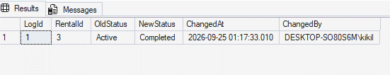

**Негативный вызов (попытка установки некорректного статуса):**

```sql
UPDATE dbo.Rentals SET Status = 'UnknownStatus' WHERE RentalId = 3;
-- Результат: Ошибка Msg 547 (конфликт с CHECK constraint таблицы dbo.Rentals).
```

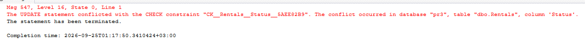

## Тесты к Требованию 2 (Расчёт примерного запаса хода)

**Позитивный вызов (вызов в SELECT по автопарку):**

```sql
SELECT CarId, Model, BatteryLevel, MaxRangeKm,
       dbo.fn_GetEstimatedRange(MaxRangeKm, BatteryLevel) AS EstimatedRangeKm
FROM dbo.Cars;
-- Результат: Tesla Model 3 (528 км, 95%) -> 501.60 км; BMW i3 (260 км, 82%) -> 213.20 км.
```

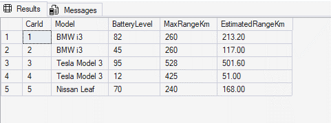

**Граничный вызов (обработка некорректных значений и NULL):**

```sql
SELECT dbo.fn_GetEstimatedRange(NULL, 80) AS ResNull,
       dbo.fn_GetEstimatedRange(300, -10) AS ResNeg,
       dbo.fn_GetEstimatedRange(300, 150) AS ResOver;
-- Результат: возвращает 0.00, 0.00 и 300.00 (ограничение до 100%), без ошибок.
```

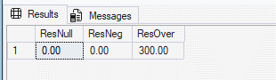

## Тесты к Требованию 3 (Оформление аренды)

**Позитивный вызов (оформление доступного авто):**

```sql
DECLARE @NewId INT;
EXEC dbo.sp_CreateRental @CustomerId = 1, @CarId = 3, @DriverId = 1, @BaseCost = 3500.00, @NewRentalId = @NewId OUTPUT;
SELECT CarId, Status FROM dbo.Cars WHERE CarId = 3;
-- Результат: аренда создана, статус авто изменен на 'Rented'.
```

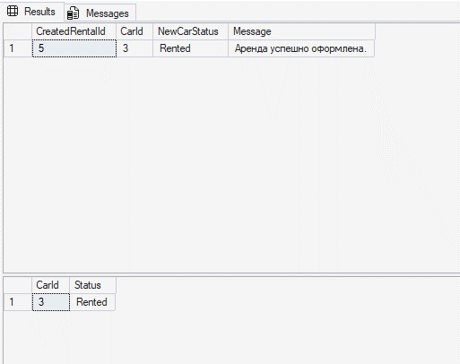

**Негативный вызов (попытка аренды машины на зарядке с зарядом 12%):**

```sql
EXEC dbo.sp_CreateRental @CustomerId = 2, @CarId = 4, @DriverId = 2, @BaseCost = 2000.00;
-- Результат: Msg 50015: "Ошибка оформления: Автомобиль недоступен для аренды. Текущий статус: 'Charging'."
```

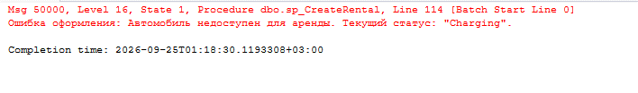

## Тесты к Требованию 4 (Завершение аренды и расчёт стоимости)

**Позитивный вызов (штатное закрытие аренды):**

```sql
EXEC dbo.sp_CompleteRental @RentalId = 3, @EndOdometer = 9875.20, @ExtraCost = 250.00, @HasAccident = 0, @EndBatteryLevel = 65;
SELECT RentalId, DistanceCovered, TotalCost, Status FROM dbo.Rentals WHERE RentalId = 3;
-- Результат: DistanceCovered = 75.00 км, TotalCost = 2050.00 руб., Status = 'Completed'.
```

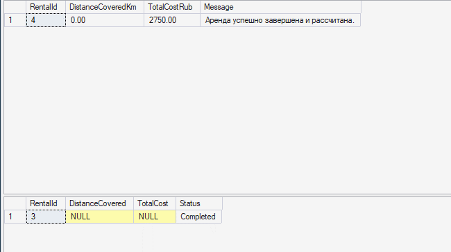

**Негативный вызов (попытка закрыть уже завершенную аренду):**

```sql
EXEC dbo.sp_CompleteRental @RentalId = 1, @EndOdometer = 15300.00;
-- Результат: Msg 50021: "Ошибка завершения: Невозможно завершить аренду со статусом 'Completed'."
```

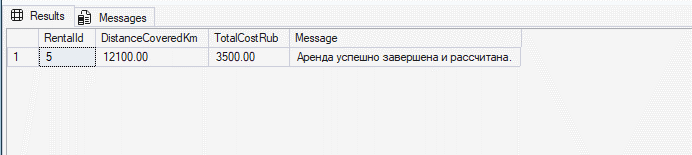

## Тесты к Требованию 5 (Авто-перевод в зарядку при разряде)

**Позитивный вызов (разряд батареи ниже 20%):**

```sql
UPDATE dbo.Cars SET BatteryLevel = 15 WHERE CarId = 1;
SELECT CarId, Model, BatteryLevel, Status FROM dbo.Cars WHERE CarId = 1;
-- Результат: статус авто автоматически изменился на 'Charging'.
```

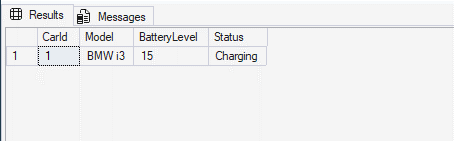

**Граничный вызов (разряд авто в статусе Maintenance):**

```sql
UPDATE dbo.Cars SET BatteryLevel = 10 WHERE CarId = 5;
SELECT CarId, Status FROM dbo.Cars WHERE CarId = 5;
-- Результат: статус остался 'Maintenance' (приоритет ТО сохранен).
```

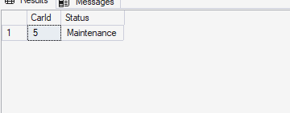

## Тесты к Требованию 6 (Рейтинг надёжности водителя)

**Позитивный вызов (расчёт рейтинга водителей в SELECT):**

```sql
SELECT FullName, TotalRents, AccidentCount,
       dbo.fn_GetDriverSafetyRating(TotalRents, AccidentCount) AS SafetyRating
FROM dbo.Drivers;
-- Результат: Ольга Смирнова (52 аренды, 1 авария) -> 98.08%; Дмитрий Волков (8 аренд, 2 аварии) -> 75.00%.
```

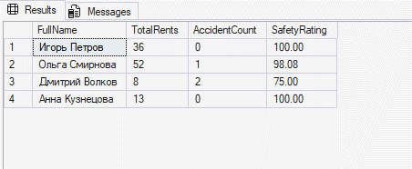

**Граничный вызов (водитель с 0 поездок):**

```sql
SELECT dbo.fn_GetDriverSafetyRating(0, 0) AS ZeroRating,
       dbo.fn_GetDriverSafetyRating(5, 10) AS MoreAccidents;
-- Результат: возвращает 0.00% без ошибки деления на ноль.
```

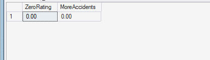

## Тесты к Требованию 7 (Фиксация зарядки)

**Позитивный вызов (завершение зарядки авто):**

```sql
EXEC dbo.sp_CompleteCharging @LogId = 2, @ChargeTo = 92;
SELECT CarId, BatteryLevel, Status FROM dbo.Cars WHERE CarId = 4;
-- Результат: сессия закрыта, списано 80 кВт·ч, уровень батареи = 92%, статус переведен в 'Available'.
```

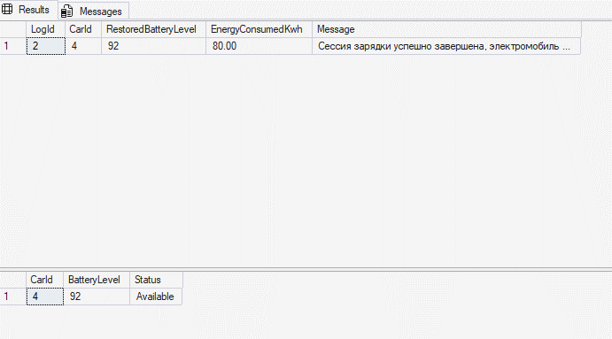

**Негативный вызов (значение ChargeTo меньше ChargeFrom):**

```sql
EXEC dbo.sp_CompleteCharging @LogId = 2, @ChargeTo = 8;
-- Результат: Msg 50033: "Ошибка фиксации зарядки: Конечный заряд (8%) не может быть меньше начального (12%)."
```

## Тесты к Требованию 8 (Защита от аренды неисправного авто)

**Позитивный вызов (назначение доступного авто со статусом Available):**

```sql
UPDATE dbo.Rentals SET CarId = 3 WHERE RentalId = 3;
-- Результат: Запрос успешно выполнен, 1 строка изменена.
```

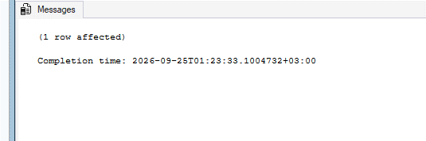

**Негативный вызов (попытка прямого UPDATE автомобиля со статусом Maintenance):**

```sql
UPDATE dbo.Rentals SET CarId = 5 WHERE RentalId = 4;
-- Результат: Msg 50002: откат транзакции триггером (подробный протокол в разделе 5).
```

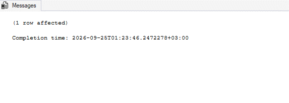